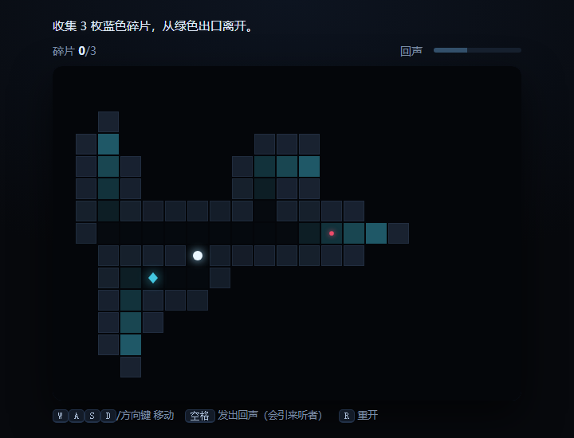

# 回声 · Echo

一个用键盘玩的单人迷宫游戏。下载项目后，双击本目录的 `index.html` 即可离线游玩。音效也由浏览器在本地生成。

## 想做什么

让探路本身成为一次选择。黑暗中，你可以慢慢摸索，也可以发出回声看清前路。可是一旦发声，附近的听者也会知道你刚才站在哪里。

## 做了什么

白点是玩家，用方向键或 WASD 移动。收集三个蓝色菱形碎片，再走进绿色方框出口即可通关。每次打开页面，首局都会从同一个岔路开始。按 R 可以重开，之后的迷宫随机生成。

按空格会响起一短一弱两声回响。蓝光每 90 毫秒沿通道前进一格，最远照出九步内的区域。每格的光从抵达时开始，在约 2.6 秒内淡去。右上角的回声条约 1.8 秒后充满。

首局可以在起点发声，向下走两格再左转去拿第一枚碎片。留意右侧的红点：听者会走到原来的发声格，短暂停留。玩家和听者只要进入同一格，就会立即结束本局。

## 遇到的问题与处理方式

- **旧版回声一发出就点亮了远处的格子。** 现在按通道的最短步数给格子分组，波头每前进一步才显示下一组。隔墙的碎片会等到声波绕过拐角才显形。
- **地图一直亮着，玩家就不用记路。** 每次探路都记录格子最近一次显形的时间，再按经过时间降低亮度。走过的岔路会逐渐变暗，玩家要决定是否值得再次发声。

- **玩家主动走进听者时，旧版有时允许擦身而过。** 现在双方每次移动后都立即检查是否同格。已验证两个方向的碰撞，并确认同格判负优先于捡碎片和通关。
